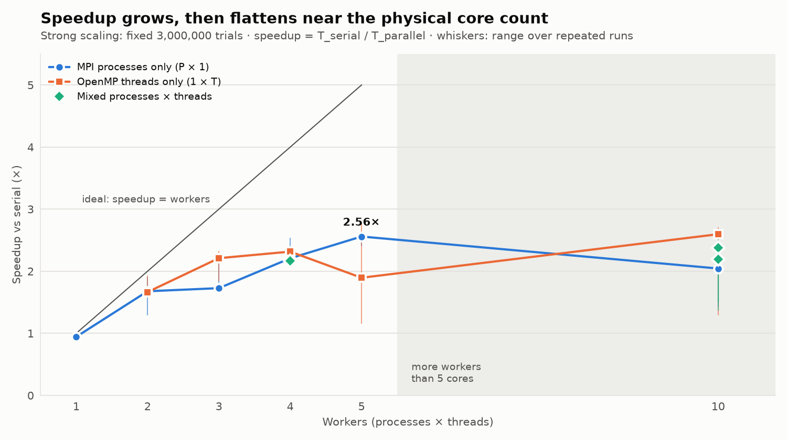

# Parallel Monte Carlo Investment & Risk Simulator (MPI + OpenMP)

A hybrid-parallel C++ engine that simulates millions of possible futures of an investment,
month by month, and reports the typical outcome, the spread of good and bad outcomes (a
"fan chart"), and the **Value at Risk (VaR)**. **MPI** splits the work across processes and
**OpenMP** splits each process's share across threads. The results are identical whatever
the number of processes and threads.

Course project for Parallel & Distributed Computing (PDC), BS Software Engineering,
FAST NUCES Karachi, Fall 2026.
Team: Maryam Mustafa (23k-2046), Umaima Fatima (23k-3043).


## Results at a glance

10,000 invested for 10 years at 7 % expected return and 15 % volatility per year,
1,000,000 simulated futures:

| | Result |
|---|---|
| Typical outcome (median) | **17,983** (average 20,094, pulled up by a few very good futures) |
| Bad / good case (5th / 95th percentile) | 8,245 / 39,050 |
| **Value at Risk, 95 %** | **1,755**: with 95 % confidence you won't lose more than this |
| Chance of ending below 10,000 | 10.8 % |
| Best speedup on the 5-core test VM | **2.56×** (19.5 s → 7.6 s, 3 M trials, 5 MPI processes) |
| Serial vs parallel results | **bit-identical** for all 16 tested processes × threads layouts |
| Accuracy vs exact computation | within **0.005 %** (5 M trials) |

## Objectives achieved

The objectives from the project proposal, and where each is shown:

| # | Objective | Status | Evidence |
|---|---|---|---|
| O1 | Monte Carlo engine: month-by-month growth under random returns | ✅ | [src/core/](src/core/); simulated mean equals V0·(1 + μ/12)^T within 0.3 SE ([test_analytic_moments.cpp](tests/cpp/test_analytic_moments.cpp)) |
| O2 | Hybrid MPI + OpenMP parallelisation (processes → threads) | ✅ | [src/hybrid/main_hybrid.cpp](src/hybrid/main_hybrid.cpp); `mpirun -np P ... --threads T` equals serial for 16 layouts ([consistency_test.sh](tests/consistency_test.sh)) |
| O3a | Median projected value over time | ✅ | `median` column of `fan_chart.csv` ([example](results/sample/fan_chart.csv)) |
| O3b | Best/worst-case bands (P5 / P95) | ✅ | `p05`, `p95` columns of `fan_chart.csv`; shaded bands in the [fan chart](docs/images/fan_chart.png) |
| O3c | Value at Risk at a confidence level | ✅ | `risk.var` in `summary.json` ([example](results/sample/summary.json)); [distribution chart](docs/images/distribution.png) |
| O4 | Benchmark: time, speedup, scalability for varying processes/threads | ✅ | [results/benchmark.csv](results/benchmark.csv), 4 charts, [benchmark report](docs/benchmark-report.md) |
| O5 | Simple, clear output: charts and a basic dashboard | ✅ | [fan chart](docs/images/fan_chart.png), [distribution](docs/images/distribution.png), Streamlit [dashboard](dashboard/app.py) |

## Quick start

On Ubuntu 24.04 (native, VirtualBox VM or WSL2):

```bash
sudo apt update
sudo apt install -y build-essential openmpi-bin libopenmpi-dev python3-venv python3-pip git
git clone https://github.com/maryammustafa05/parallel-monte-carlo-simulator.git
cd parallel-monte-carlo-simulator
bash scripts/setup_env.sh        # checks the tools, creates .venv with the Python packages (~1 min)
make                             # builds build/mc_serial and build/mc_hybrid (no warnings)
make test                        # every test, ~1 min → "ALL TESTS PASSED"
```

**Run a simulation and draw the charts** (about 10 s):

```bash
bash scripts/run_demo.sh         # 1,000,000 futures on up to 4 MPI processes → docs/images/*.png
```

Its simulation step prints (real run on the 5-core VM):

```
mc_hybrid: 1000000 trials x 120 months, 4 process(es) x 1 thread(s)
  time: total 2.843 s (compute 2.837 s, reduce 0.007 s)
  final value: mean 20093.63  median 17983.26  P5 8245.17  P95 39049.85
  VaR(95%): 1754.83   P(loss): 0.1075   histogram overflow: low 0, high 0
  checksum 8d550353ce5046de   wrote results/demo/{fan_chart.csv, final_hist.csv, summary.json}
```

**Run it yourself**, serially or with P processes × T threads. Same seed means same results
and checksum:

```bash
./build/mc_serial --trials 1000000
mpirun --bind-to none -np 2 ./build/mc_hybrid --trials 1000000 --threads 2
```

**Dashboard**: sliders, a Run button, charts:

```bash
.venv/bin/streamlit run dashboard/app.py      # then open http://localhost:8501
```

**Benchmark** (10–20 minutes): `make bench`.

Every option, the output files, the dashboard and troubleshooting are explained in the
**[user guide](docs/user-guide.md)**. If Open MPI prints *"Authorization required, but no
authorization protocol specified"* on a VM, it's harmless: `export HWLOC_COMPONENTS=-gl` hides it.

## How it works

1. **The model.** Each simulated future starts at V0. Every month a random return
   r = max(−1, μ/12 + σ/√12 · Z), with Z ~ Normal(0, 1), is applied: V ← V·(1 + r).
2. **No paths are stored.** Each month has a histogram of 2048 log-spaced bins; a trial only
   adds 1 to the right bin. Memory is about 2 MB per worker for any number of trials, and
   merging results is just adding counts.
3. **Chunks with their own seeds.** Trials are cut into chunks of 4096, and each chunk's random
   numbers depend only on (seed, chunk number). Whoever runs a chunk gets the same numbers, so
   results are identical for any layout. A printed **checksum** proves it.
4. **Two levels of parallelism.** MPI gives each process a contiguous block of chunks;
   OpenMP threads share the block, each filling a private histogram (no locks). Threads merge
   once in `omp critical`; processes combine with `MPI_Reduce` onto process 0, which writes
   the results.

Details: **[architecture](docs/architecture.md)** (components, data flow, a run step by step)
and **[design decisions](docs/design-decisions.md)** (why each choice, what else we
considered, and how we verified it).


## Correctness

| Check | Result |
|---|---|
| Exact formulas: E[V_T] = V0(1 + μ/12)^T, E[V_T²] | simulated values within 4 standard errors (e.g. 20,093.63 vs 20,096.61 = −0.3 SE) |
| Histogram vs exact sorting (`--exact`) | median, P5, P95, VaR within **0.005 %** at 5 M trials (target < 1 %) |
| Independent NumPy implementation (other code, other RNG) | 19 statistics agree within ±1.8 SE; an 8 % instead of 7 % return would show as 50 SE |
| Serial vs parallel | identical checksums for 16 layouts: 1–4 processes × 1, 2, 4 threads, uneven splits, processes with no work |
| Edge cases | 1 trial, zero volatility (exact answer known), 1 month, portfolios wiped out, invalid input |

## Performance



3,000,000 trials × 120 months on a VirtualBox VM with 5 cores (host: Intel i7-10610U, 4
physical cores, 15 W), medians of 3 interleaved runs:

| Processes × threads | Time | Speedup | Efficiency |
|---|---|---|---|
| serial baseline (`mc_serial`, no MPI/OpenMP) | 19.51 s | 1.00 | 100 % |
| 2 × 1 | 11.63 s | 1.68 | 84 % |
| 1 × 4 | 8.42 s | 2.32 | 58 % |
| **5 × 1** | **7.62 s** | **2.56** | 51 % |
| 10 workers on 5 cores (oversubscribed) | 7.5–9.6 s | 2.0–2.6 | 20–26 % |

**Why not 5×?** Not serial code or communication: the MPI reduce takes 2–8 ms (< 0.1 %),
and Amdahl's law with the measured serial part predicts 4.99×. A weak-scaling test shows each
core gets slower when the others are busy, and an experiment traced much of that to the
**shared 8 MB CPU cache**: each worker's 2 MB of histograms stop fitting at 4–5 workers
(smaller histograms raised weak-scaling efficiency from 74 % to 92 %). The rest is a
power-limited laptop CPU with 4 physical cores. Full method, tables and charts:
**[benchmark report](docs/benchmark-report.md)**.

## Testing

`make test` runs everything in about a minute, and passes on a fresh clone after
`bash scripts/setup_env.sh`. [GitHub Actions](.github/workflows/ci.yml) runs it on every push.

| Level | What | Where |
|---|---|---|
| Unit (C++) | RNG, merging, work split, percentiles/VaR, input parsing and limits: 244 checks | [tests/cpp/](tests/cpp/) |
| Consistency | serial == parallel for 16 layouts | [tests/consistency_test.sh](tests/consistency_test.sh) |
| Edge cases | unusual inputs, serial and under `mpirun` | [tests/edge_cases.sh](tests/edge_cases.sh) |
| Python | NumPy reference, charts for extreme runs, benchmark maths, dashboard run | [tests/python/](tests/python/) |

## Documentation

| Document | For |
|---|---|
| [User guide](docs/user-guide.md) | installing, every option, reading the outputs, charts, dashboard, benchmark, troubleshooting |
| [Architecture](docs/architecture.md) | components, data flow, what happens during a parallel run, memory, file formats |
| [Design decisions](docs/design-decisions.md) | why histograms, per-chunk seeds, own RNG, the work split, fair benchmarking, and more |
| [Benchmark report](docs/benchmark-report.md) | method, all results, and the explanation of the speedup curve |
| [Demo outline](docs/demo-outline.md) | a timed 5-minute live demo with commands and likely questions |
| [Proposal](docs/proposal/proposal.pdf) | the original project proposal |
| [CLAUDE.md](CLAUDE.md) | the full technical specification the project was built from |

## Repository layout

```
src/core/       simulation engine shared by every program (no MPI / OpenMP)
src/serial/     serial baseline: mc_serial
src/hybrid/     MPI + OpenMP driver: mc_hybrid
tests/          C++ unit tests, consistency and edge-case scripts, Python tests
scripts/        setup, demo, benchmark runner, chart scripts
dashboard/      Streamlit dashboard
docs/           documentation, benchmark report, chart images
results/        sample/ (one small example run) and the benchmark data; other runs are not committed
```

## Known limitations

- **One machine only.** All measurements are on a single 5-core VM, where processes and
  threads compete for the same cache, memory and power budget. MPI's main strength, spreading
  work over several machines, isn't measured.
- **VM timing noise.** The host's power state changes speeds by up to 2× between sessions; the
  benchmark uses interleaved repeats and medians, and the charts show the spread.
- **Deliberately simple model.** Independent normal monthly returns with a −100 % floor: no
  fat tails, no monthly contributions, no real market data (out of scope for this project).

## Roadmap

- [x] **Phase 0:** repository skeleton, toolchain check, MPI + OpenMP hello test
- [x] **Phase 1:** serial Monte Carlo engine (O1)
- [x] **Phase 2:** OpenMP threads (O2, part 1)
- [x] **Phase 3:** MPI processes (O2, part 2)
- [x] **Phase 4:** analytics: percentiles, VaR, exact-mode validation (O3)
- [x] **Phase 5:** Matplotlib charts and Streamlit dashboard (O5)
- [x] **Phase 6:** benchmark and scalability report (O4)
- [x] **Phase 7:** edge-case tests and hardening
- [x] **Phase 8:** final documentation and demo

## License

MIT. See [LICENSE](LICENSE).
