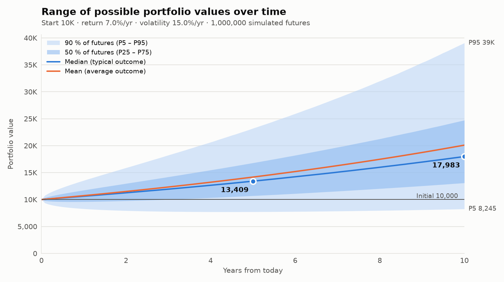
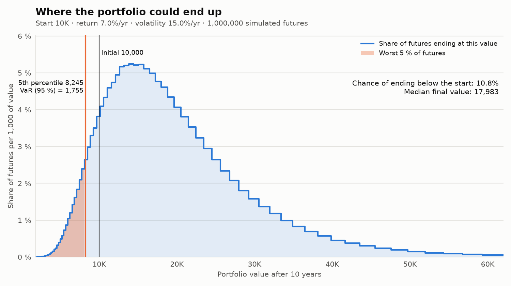

# Parallel Monte Carlo Investment & Risk Simulator (MPI + OpenMP)

A hybrid-parallel C++ engine that simulates millions of possible futures of an
investment and reports the median path, the 5th–95th percentile "fan", and the
95 % Value at Risk (VaR). **MPI** splits the trials across processes, and
**OpenMP** splits each process's share across threads.

Course project for Parallel & Distributed Computing (PDC), BS Software Engineering,
FAST NUCES Karachi, Fall 2026.
Team: Maryam Mustafa (23k-2046), Umaima Fatima (23k-3043).

> **Status:** Phase 5 done: the engine runs on MPI processes × OpenMP threads with results
> identical to the serial run, is validated against exact values and an independent NumPy
> implementation, and has charts plus a Streamlit dashboard. Next: Phase 6 (benchmark).



---

## Requirements

Ubuntu 24.04 (native, VM or WSL2) with:

```bash
sudo apt update
sudo apt install -y build-essential openmpi-bin libopenmpi-dev python3-venv python3-pip git
```

Then, from the repository root:

```bash
bash scripts/setup_env.sh        # checks the tools, creates .venv, installs Python packages
source .venv/bin/activate
```

Verified on the development VM: g++ 13.3.0, Open MPI 4.1.6, Python 3.12.3, 5 logical cores.

## Quick check: MPI + OpenMP "hello"

```bash
make                                                    # builds build/hello
OMP_NUM_THREADS=2 mpirun --bind-to none -np 2 ./build/hello
```

Expected output: four lines, one per (rank, thread) pair. The order varies from run to run.

```
hello from rank 0 of 2, thread 0 of 2
hello from rank 0 of 2, thread 1 of 2
hello from rank 1 of 2, thread 0 of 2
hello from rank 1 of 2, thread 1 of 2
```

### Known harmless message: "Authorization required, but no authorization protocol specified"

On a VM with a desktop, Open MPI's hardware-detection library (hwloc) tries to
contact the display server to look for GPUs and prints this line several times.
It does not affect results. To silence it, disable hwloc's graphics plugin:

```bash
export HWLOC_COMPONENTS=-gl      # add to ~/.bashrc to make it permanent
```

## Run the serial simulator

```bash
make                                   # builds build/mc_serial (and the tests)
./build/mc_serial --trials 1000000     # 1 million futures, 120 months, defaults below
./build/mc_serial --help               # all options
```

Real output on the development VM (seed 42, defaults: V0 = 10 000, mu = 7 %/year,
sigma = 15 %/year, 120 months):

```
mc_serial: 1000000 trials x 120 months, 1 process(es) x 1 thread(s)
  time: total 30.919 s (compute 30.913 s, reduce 0.000 s)
  final value: mean 20093.63  median 17983.26  P5 8245.17  P95 39049.85
  VaR(95%): 1754.83   P(loss): 0.1075   histogram overflow: low 0, high 0
  checksum ...   wrote results/run/fan_chart.csv and results/run/summary.json
```

In words: after 10 years the typical (median) outcome is about 17 980, the average is
about 20 090, and with 95 % confidence you will not lose more than about 1 755 of
your 10 000. About 10.8 % of the futures end below the starting amount.
The simulated mean (20 093.63) matches the exact formula V0·(1 + mu/12)^120 = 20 096.61
to within 0.3 standard errors.

Outputs (format details in [CLAUDE.md](CLAUDE.md) section 8):

| File | Contents |
|---|---|
| `results/run/fan_chart.csv` | per month: P5, P25, median, P75, P95, mean |
| `results/run/summary.json` | parameters, final-value stats, VaR, overflow counters, histogram checksum, timing (+ an `exact` section with `--exact`) |
| `results/run/final_hist.csv` | histogram of the final month: `bin_lower,bin_upper,count` (for the distribution chart) |

**Note on speed:** this 30.9 s run was taken while the VM was running slowly. Later the same run took about 6.5 s (see the parallel section below). Speed changes the times, never the results.

## Run in parallel (MPI processes × OpenMP threads)

```bash
export HWLOC_COMPONENTS=-gl      # optional: hides a harmless hwloc message (see above)
mpirun --bind-to none -np 2 ./build/mc_hybrid --trials 1000000 --threads 2
```

- `-np P` starts P **processes**. The 4096-trial chunks are split into P contiguous
  blocks (if they don't divide evenly, the first processes get one extra chunk).
- `--threads T` starts T OpenMP **threads** inside each process. They share that
  process's block, each filling a private histogram that is merged at the end.
- `MPI_Reduce` then adds all processes' histograms and sums on process 0, which is
  the only one that writes files.
- `--bind-to none` stops Open MPI from pinning each process to one core, which would
  squeeze all of its threads onto that core. If you ask for more processes than the
  VM has cores, also add `--oversubscribe`.

Because every chunk has its own random seed, the result does not depend on P or T.
The `checksum` (a fingerprint of every histogram count) is identical for `mc_serial`
and every `mpirun -np 1/2/3/4 ... --threads 1/2/4` combination (checked by `make test`).

Real runs on the development VM, 1 000 000 trials × 120 months, one run each,
checksum `8d550353ce5046de` every time:

| Processes × threads | Workers | Total | Compute | Reduce (MPI) | Speedup vs serial |
|---|---|---|---|---|---|
| `mc_serial` | 1 | 6.46 s | 6.46 s | — | 1.00 |
| 1 × 1 | 1 | 6.26 s | 6.26 s | 0.000 s | 1.03 |
| 2 × 1 | 2 | 3.50 s | 3.50 s | 0.003 s | 1.85 |
| 2 × 2 | 4 | 2.45 s | 2.45 s | 0.002 s | 2.64 |
| 1 × 4 | 4 | 2.43 s | 2.43 s | 0.000 s | 2.66 |
| 4 × 1 | 4 | 2.49 s | 2.48 s | 0.004 s | 2.60 |
| 5 × 1 | 5 | 2.06 s | 2.06 s | 0.006 s | 3.13 |

What this shows: combining results is almost free (a few milliseconds to send
about 2 MB of counts per process), so nearly all the time is simulation. Four
workers give about 2.6× instead of 4×. The likely reason is that the host CPU has only 4
physical cores shared with Windows, but this is a first look, not the benchmark.
Phase 6 repeats every configuration 3 times and reports medians.

**About the VM's speed:** during Phases 1–2 the same serial run took about 31 s and
single-threaded times jumped around by up to 2×. When these numbers were taken it
was steady at about 6.5 s. Host conditions (power mode, other Windows programs)
clearly matter a lot, so benchmark runs must all be taken in one session under the
same conditions.

## How we know the numbers are right

The fan chart and VaR are read from per-month histograms (memory stays at about 2 MB
however many trials you run). Two independent checks show this shortcut is accurate:

**1. `--exact` mode.** It also keeps every final value, sorts them, and computes the true
percentiles and VaR, then reports how far the histogram answers are from them:

```bash
mpirun --bind-to none -np 5 ./build/mc_hybrid --trials 5000000 --exact
```

Real results (the plan's limit is 1 % difference):

| Trials | Median | P5 | P95 | VaR (95 %) |
|---|---|---|---|---|
| 1 000 000 | 0.0021 % | 0.0003 % | 0.0012 % | 0.0013 % |
| 5 000 000 | 0.0001 % | 0.0010 % | 0.0023 % | 0.0049 % |

`--exact` is for validation only (`--trials` ≤ 10 000 000). On MPI the values are
collected with `MPI_Gatherv` after the timer stops, so it never distorts timings.

**2. An independent NumPy implementation** ([tests/python/reference_numpy.py](tests/python/reference_numpy.py)).
It shares no code with the C++ engine, uses a different random generator (PCG64) and exact
percentiles. Because the random numbers differ, the results differ by Monte Carlo noise,
so the test ([tests/python/test_reference.py](tests/python/test_reference.py)) requires
agreement within 4 standard errors (SE). Real output, 200 000 trials each:

```
  final p05   : C++    8254.39  NumPy    8228.08  diff +1.01 SE
  final median: C++   17977.86  NumPy   17967.44  diff +0.31 SE
  final p95   : C++   39085.69  NumPy   39103.76  diff -0.15 SE
  month  60 median: C++   13406.02  NumPy   13409.39  diff -0.19 SE
  mean     : C++   20095.24  NumPy   20095.43  diff -0.01 SE
  VaR      : C++    1745.66  NumPy    1771.92  diff -1.01 SE
  P(loss)  : C++     0.1075  NumPy     0.1083  diff -0.80 SE
```

Every one of the 19 comparisons is within ±1.8 SE. The test is also sensitive: if the
reference used a 1-point higher return (8 % instead of 7 %), the median would differ
by about 50 SE and the test would fail.

## Charts and dashboard

**One command** builds, runs 1 000 000 futures on up to 4 MPI processes, and draws both charts:

```bash
bash scripts/run_demo.sh                    # extra flags are passed on, e.g. --sigma 0.25
```

Or draw the charts for any run folder yourself:

```bash
.venv/bin/python scripts/plot_fan_chart.py    --input results/run --output docs/images/fan_chart.png
.venv/bin/python scripts/plot_distribution.py --input results/run --output docs/images/distribution.png
```

| Chart | What it shows |
|---|---|
| [Fan chart](docs/images/fan_chart.png) (top of this page) | For every month: the middle 50 % and 90 % of futures as shaded bands, the median (typical) and mean (average) path, and the starting amount |
| [Distribution](docs/images/distribution.png) (below) | Where the portfolio ends after the horizon. The worst 5 % of futures are shaded orange; the orange line is the 5th percentile, and the gap from it to the starting amount is the 95 % VaR |



The mean ends above the median because a few very good futures pull the average up
(the long right tail in the distribution chart). The median is the better "typical outcome".

### Dashboard

```bash
.venv/bin/streamlit run dashboard/app.py
```

Then open **http://localhost:8501**. When working over VS Code Remote-SSH, VS Code
forwards the port from the VM automatically (see the *Ports* tab), so the address works
in the Windows browser. In the sidebar, choose the investment (amount, return,
volatility, years, VaR confidence), the number of simulated futures, and the number of
MPI processes and OpenMP threads, then press **Run simulation**. The dashboard runs
`mpirun ... build/mc_hybrid` and shows the median, VaR, chance of loss and compute time,
the two charts, a table of the fan chart, and the exact command and output. Each run is
saved under `results/dashboard/<date-time>/`.

`make test` also checks the dashboard: [tests/python/test_dashboard.py](tests/python/test_dashboard.py)
loads the real app with Streamlit's `AppTest`, presses **Run simulation** for a
2 processes × 2 threads run, and checks that the results appear.

## Build targets

| Command | What it does |
|---|---|
| `make` | Builds everything: `build/hello`, `build/mc_serial`, `build/mc_hybrid`, test binaries |
| `make serial` | Serial baseline `build/mc_serial` |
| `make hybrid` | MPI + OpenMP engine `build/mc_hybrid` |
| `make test` | Builds and runs all tests: C++ unit tests, end-to-end checks, serial == hybrid consistency, C++ vs NumPy, dashboard (needs `.venv`) |
| `make bench` | Runs the scalability benchmark (Phase 6) |
| `make clean` | Deletes `build/` |

## Repository layout

```
src/core/      simulation engine shared by both programs (no MPI / OpenMP here)
src/serial/    serial baseline driver
src/hybrid/    MPI + OpenMP driver
tests/         C++ unit tests, Python reference check, serial-vs-parallel consistency
scripts/       setup, demo, benchmark and plotting scripts
dashboard/     Streamlit dashboard
docs/          proposal, design notes, benchmark report, images
results/       run outputs (only results/sample/ is committed)
```

See [CLAUDE.md](CLAUDE.md) for the full specification and design decisions.

## Roadmap

- [x] **Phase 0:** repository skeleton, toolchain check, MPI + OpenMP hello test
- [x] **Phase 1:** serial Monte Carlo engine (O1)
- [x] **Phase 2:** OpenMP threads (O2, part 1)
- [x] **Phase 3:** MPI processes (O2, part 2)
- [x] **Phase 4:** analytics: percentiles, VaR, exact-mode validation (O3)
- [x] **Phase 5:** Matplotlib charts and Streamlit dashboard (O5)
- [ ] **Phase 6:** benchmark and scalability report (O4)
- [ ] **Phase 7:** edge-case tests and hardening
- [ ] **Phase 8:** final documentation and demo

## License

MIT. See [LICENSE](LICENSE).
