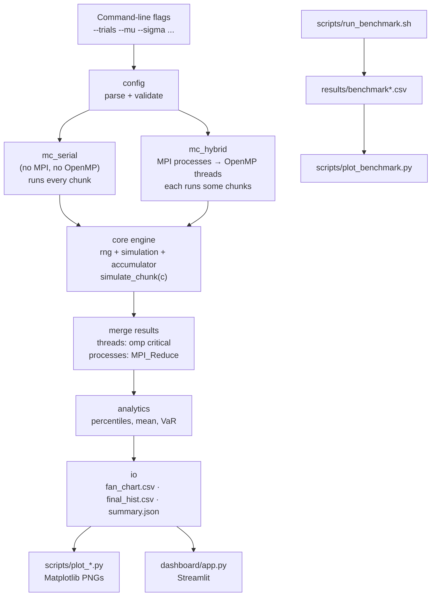

# Architecture

How the parts of the simulator fit together. For *why* it's built this way, see
[design-decisions.md](design-decisions.md).

## The big picture



**Layering rule:** `src/core/` contains no MPI and no OpenMP. All parallelism lives in one
file, [src/hybrid/main_hybrid.cpp](../src/hybrid/main_hybrid.cpp). The core is compiled once
and linked into both programs and the tests (design decision D8).

## Modules

| File | Responsibility |
|---|---|
| [src/core/config.*](../src/core/config.hpp) | `Config` struct with defaults; parses `--flag value` arguments; checks every input is in range |
| [src/core/rng.hpp](../src/core/rng.hpp) | `splitmix64`, `xoshiro256**` uniform generator, Box–Muller normal generator; `chunk_seed(seed, c)` |
| [src/core/simulation.*](../src/core/simulation.hpp) | the model: monthly μ/σ, per-month log-space bin layout, `chunk_block()` work split, `simulate_chunk()` |
| [src/core/accumulator.*](../src/core/accumulator.hpp) | everything remembered about a batch of trials (histograms, sums, min/max, counters); `merge()`; `checksum()` |
| [src/core/analytics.*](../src/core/analytics.hpp) | percentiles from histograms, fan-chart rows, final-value statistics, VaR; exact percentiles for `--exact` |
| [src/core/io.*](../src/core/io.hpp) | writes `fan_chart.csv`, `final_hist.csv`, `summary.json` (by hand, no JSON library); prints the run report |
| [src/serial/main_serial.cpp](../src/serial/main_serial.cpp) | baseline: one loop over every chunk |
| [src/hybrid/main_hybrid.cpp](../src/hybrid/main_hybrid.cpp) | MPI init, block split, OpenMP loop with private accumulators, `MPI_Reduce`, timing, rank-0 output |
| [scripts/](../scripts/) | demo, benchmark runner, chart scripts (+ shared `chart_style.py`), environment check |
| [dashboard/app.py](../dashboard/app.py) | Streamlit UI that runs `mpirun ... mc_hybrid` and shows the results |
| [tests/](../tests/) | C++ unit tests, consistency and edge-case scripts, NumPy reference and Python tests |

## One trial, month by month

```
V = V0
for t = 1 .. T:
    Z  = next Normal(0,1) from this chunk's generator
    r  = max(-1, mu/12 + sigma/sqrt(12) * Z)       # monthly return, a loss can't exceed 100 %
    V  = V * (1 + r)
    month_sum[t]  += V                              # for the mean
    hist[t][bin(V)] += 1    (or month_zero[t] += 1 if V == 0)
record final V: sum, sum of squares, min, max, loss counter
```

## What happens at run time

Example: `mpirun -np 2 ./build/mc_hybrid --trials 50000 --threads 2`

```
50 000 trials  →  13 chunks of 4096 (the last one has 848 trials)

MPI split (contiguous blocks, first ranks take the extra chunk):
  process 0: chunks 0–6   (7 chunks)          process 1: chunks 7–12  (6 chunks)

OpenMP split inside each process (schedule(static)):
  process 0 ── thread 0: chunks 0–3            process 1 ── thread 0: chunks 7–9
            └─ thread 1: chunks 4–6                      └─ thread 1: chunks 10–12

Each thread fills its own private accumulator (2 MB): no locks while simulating.

thread merge  : #pragma omp critical  → one accumulator per process
process merge : MPI_Reduce(MPI_SUM / MIN / MAX) → total on process 0
output        : process 0 computes analytics and writes the files
```

Because chunk *c* always uses `chunk_seed(seed, c)`, this run produces exactly the same
histogram counts as `mc_serial --trials 50000`. The checksum proves it.

### Timing points (in `mc_hybrid`)

```
MPI_Barrier ── start ──[ build bin layout · simulate own chunks ]── compute_s
MPI_Barrier ──────────[ MPI_Reduce of histograms and sums ]─────── reduce_s
                                                total_s = start → after reduce
reported value = maximum over all processes (the slowest one decides)
--exact gathering happens after this, outside the timed region
```

## Memory

Per worker (thread): `months × bins × 8 bytes` of histogram counts + `months × 16 bytes`
for sums and zero counts. Default 120 × 2048 × 8 B ≈ **2 MB**, independent of the number of
trials. Per process, add one more accumulator for the merged total. MPI sends about
2 MB per process to process 0 during the reduce. With `--exact`, each worker also stores
8 bytes per trial (limited to 10⁷ trials).

## Output files (contract between C++ and Python)

| File | Columns / fields |
|---|---|
| `fan_chart.csv` | `month,p05,p25,median,p75,p95,mean` for months 0…T |
| `final_hist.csv` | `bin_lower,bin_upper,count` for the final month's histogram (values > 0) |
| `summary.json` | `params`, `parallel` (processes, threads), `final_value` (mean, std, min, max, median, p05, p95), `risk` (var, threshold, prob_loss, prob_total_loss, confidence), `histogram` (bins, overflow counters, checksum), `timing` (total, compute, reduce), and `exact` with `--exact` |
| `results/benchmark.csv`, `benchmark_weak.csv` | `mode,processes,threads,total_workers,trials,run,total_s,compute_s,reduce_s,oversubscribed` |

The exact JSON layout is in [CLAUDE.md](../CLAUDE.md) section 8. A small real example is in
[results/sample/](../results/sample/).
