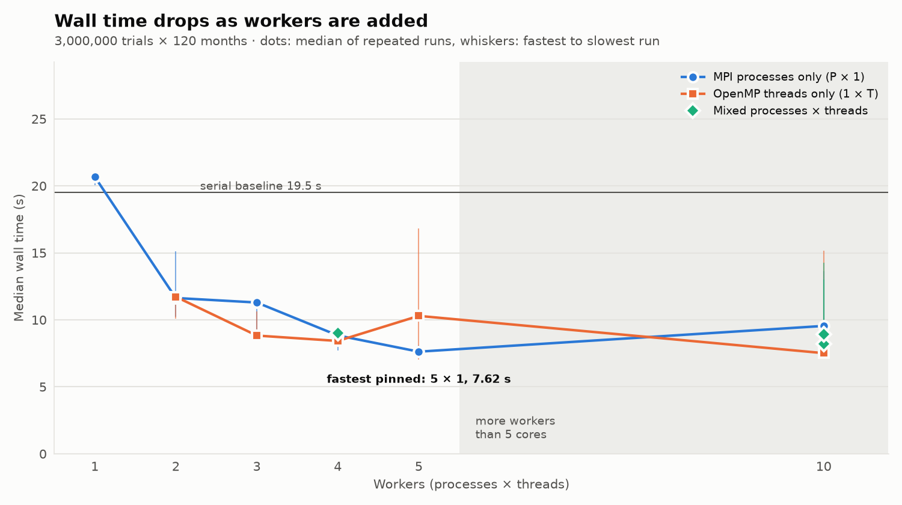
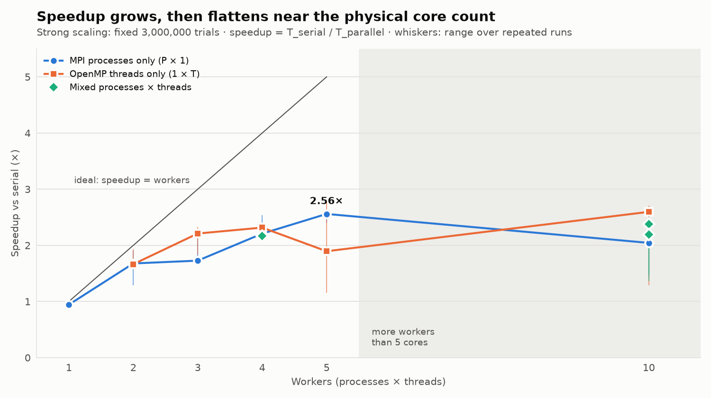
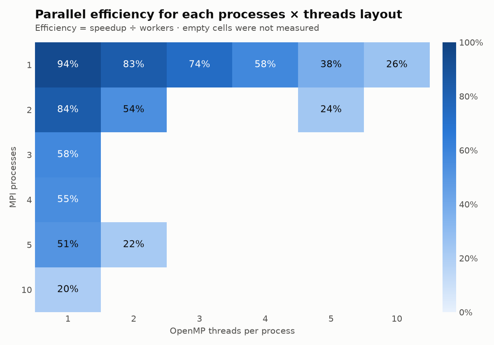
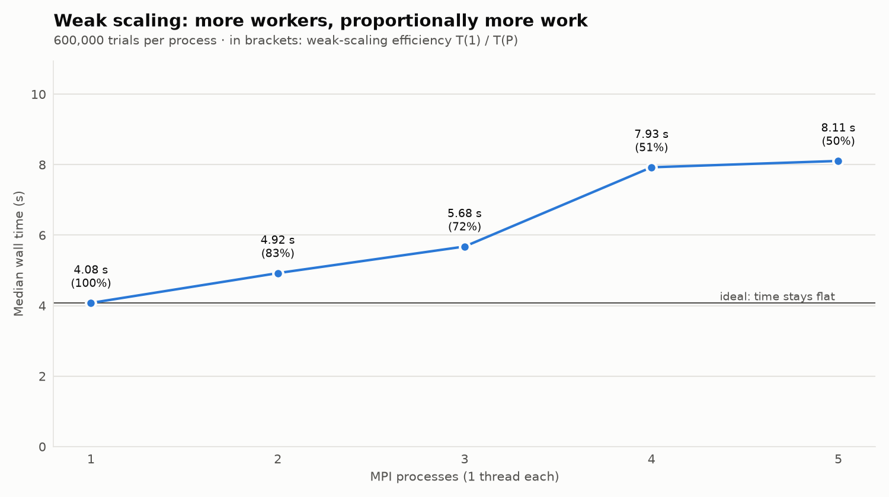

# Benchmark report

How much faster does the simulator get with more MPI processes and OpenMP threads,
and why doesn't it get faster still? Every number below comes from a real run on the
machine described next. Nothing is estimated.

## Test machine

| Item | Value |
|---|---|
| Host CPU | Intel Core i7-10610U @ 1.80 GHz: a 15 W laptop chip, 4 physical cores / 8 hardware threads, 8 MB shared L3 cache |
| VM | VirtualBox, Ubuntu 24.04 LTS, host is Windows |
| Cores given to the VM (`nproc`) | **5** (1 thread per core, as the VM sees them) |
| RAM given to the VM | 10 GiB |
| Compiler / MPI | g++ 13.3.0 (`-O3 -march=native`), Open MPI 4.1.6 |
| Date of runs | 2026-11-21 (recorded in `results/benchmark_env.txt`) |

**What this means for speedup:** the ceiling is the 5 cores the VM sees, not the host's 8
hardware threads. The host has only 4 *physical* cores, so the VM's 5 virtual cores are partly
backed by hyper-threads, and Windows runs on the same cores.

## How the benchmark was run

```bash
bash scripts/run_benchmark.sh --trials 3000000 --weak-trials 600000 --repeats 3
.venv/bin/python scripts/plot_benchmark.py      # → docs/images/benchmark_*.png, results/benchmark_summary.csv
```

(`make bench` runs both steps with these settings.)

- **Problem size:** 3,000,000 trials × 120 months = 360 million simulated months. Chosen so
  the serial run takes about 20–60 s on this VM: it took 17.9–20.4 s.
- **Baseline:** `mc_serial`, built **without** MPI and OpenMP (design decision D5).
  Speedup = T_serial / T_parallel.
- **Configurations:** every processes × threads layout with P·T ≤ 5 (11 layouts), plus four
  layouts with **10 workers on 5 cores** (oversubscribed) to show what happens past the
  core count.
- **Pinning:** when P·T ≤ 5, each process gets its own block of T cores
  (`mpirun --map-by slot:PE=T --bind-to core`) and its threads are pinned inside it
  (`OMP_PLACES=cores OMP_PROC_BIND=close`), so no two workers share a core.
  Oversubscribed runs can't be pinned (`--bind-to none --oversubscribe`).
- **Repeats:** 3 runs of every configuration, **interleaved in rounds** (round 1 of
  everything, then round 2, then round 3), so that if the host slows down for a while, all
  configurations suffer equally. We report the **median**.
- **Timing:** `MPI_Wtime()` after an `MPI_Barrier`, taking the slowest process. `compute` and
  `reduce` (communication) are measured separately.
- Raw data: [results/benchmark.csv](../results/benchmark.csv),
  [results/benchmark_weak.csv](../results/benchmark_weak.csv). Summary:
  [results/benchmark_summary.csv](../results/benchmark_summary.csv).

## Results: strong scaling (fixed problem, more workers)





| Layout | P × T | Workers | Median time (s) | Spread | Compute (s) | Reduce (ms) | Speedup | Efficiency | Karp–Flatt e |
|---|---|---|---|---|---|---|---|---|---|
| serial | 1 × 1 | 1 | 19.51 | ±6 % | 19.51 | 0.0 | 1.00 | 100% | — |
| processes | 1 × 1 | 1 | 20.67 | ±2 % | 20.67 | 0.0 | 0.94 | 94% | — |
| threads | 1 × 2 | 2 | 11.72 | ±7 % | 11.72 | 0.0 | 1.66 | 83% | 0.202 |
| processes | 2 × 1 | 2 | 11.63 | ±21 % | 11.63 | 1.9 | 1.68 | 84% | 0.192 |
| threads | 1 × 3 | 3 | 8.83 | ±13 % | 8.83 | 0.0 | 2.21 | 74% | 0.179 |
| processes | 3 × 1 | 3 | 11.29 | ±12 % | 11.29 | 4.4 | 1.73 | 58% | 0.368 |
| threads | 1 × 4 | 4 | 8.42 | ±5 % | 8.42 | 0.0 | 2.32 | 58% | 0.242 |
| mixed | 2 × 2 | 4 | 9.01 | ±3 % | 9.01 | 2.2 | 2.16 | 54% | 0.283 |
| processes | 4 × 1 | 4 | 8.84 | ±7 % | 8.83 | 6.5 | 2.21 | 55% | 0.270 |
| threads | 1 × 5 | 5 | 10.30 | ±48 % | 10.30 | 0.0 | 1.90 | 38% | 0.410 |
| processes | 5 × 1 | 5 | 7.62 | ±4 % | 7.62 | 7.5 | **2.56** | 51% | 0.238 |
| threads (oversubscribed) | 1 × 10 | 10 | 7.51 | ±53 % | 7.51 | 0.0 | 2.60 | 26% | 0.317 |
| mixed (oversubscribed) | 2 × 5 | 10 | 8.21 | ±42 % | 8.21 | 2.0 | 2.38 | 24% | 0.357 |
| mixed (oversubscribed) | 5 × 2 | 10 | 8.91 | ±28 % | 8.91 | 7.9 | 2.19 | 22% | 0.397 |
| processes (oversubscribed) | 10 × 1 | 10 | 9.55 | ±29 % | 9.53 | 16.0 | 2.04 | 20% | 0.433 |

*Spread* is half the gap between the fastest and slowest of the 3 runs, relative to the
median. *Efficiency* = speedup ÷ workers. *Karp–Flatt e* = (1/S − 1/p) / (1 − 1/p) is the
"serial fraction" the measured speedup implies.



**In short:** the best pinned layout, 5 processes × 1 thread, is **2.56× faster** than serial
(19.5 s → 7.6 s). Two workers give a solid 1.7× (84 % efficiency). After that, each extra
worker adds less and less, and at 4–5 workers efficiency is about 50–58 %.

## Results: weak scaling (problem grows with the workers)

Each process gets the same 600,000 trials, so with P processes the run does P times more
work. If every core worked at full speed regardless of the others, the time would stay flat.



| Processes | Trials | Median time (s) | Weak-scaling efficiency T(1)/T(P) |
|---|---|---|---|
| 1 | 600,000 | 4.08 | 100 % |
| 2 | 1,200,000 | 4.92 | 83 % |
| 3 | 1,800,000 | 5.68 | 72 % |
| 4 | 2,400,000 | 7.93 | 51 % |
| 5 | 3,000,000 | 8.11 | 50 % |

This is the key result for understanding the strong-scaling curve. Each process does **the
same work and almost no communication** (the reduce takes 2–8 ms), yet the time doubles from
1 to 5 processes. **So each core works more slowly when the other cores are busy.**

## Why the speedup flattens: an honest explanation

### 1. It is *not* Amdahl's law from serial code

Amdahl's law says that if a fraction *f* of the work can't be parallelised, the speedup on
*p* workers is at most 1 / (f + (1 − f)/p). In our program, the only serial part inside the
timed region is the MPI reduce plus building the bin layout: at most 7.5 ms out of 19.5 s,
so f ≈ 0.04 %. Amdahl then predicts **4.99× on 5 workers**, but we measured 2.56×.

The Karp–Flatt metric points the same way. A truly fixed serial fraction would give a
*constant* e, but ours grows from about 0.19 at 2 workers to 0.24–0.41 at 5. A growing e means
the overhead **grows with the number of workers**, which is the signature of workers
competing for shared hardware, not of serial code.

### 2. Shared cache: the histograms stop fitting (measured)

Each worker keeps 120 months × 2048 bins × 8 bytes ≈ **2 MB** of histogram counts and updates
them at random positions (wherever each trial's value falls). The CPU's last-level (L3) cache
is **8 MB, shared by all cores**. One worker's 2 MB fits; five workers need about 10 MB, so
they keep pushing each other's data out of the cache and must wait for slower main memory.

We tested this directly by re-running the two ends of the weak-scaling experiment with smaller
histograms (`--bins 256`, 0.25 MB per worker), 3 interleaved runs each, medians:

| Histogram per worker | 1 process | 5 processes | Weak-scaling efficiency |
|---|---|---|---|
| 2048 bins (2.0 MB, the default) | 4.93 s | 6.70 s | 74 % |
| 256 bins (0.25 MB) | 4.13 s | 4.47 s | **92 %** |

When the histograms fit in cache, five workers lose only 8 %. **Cache contention is a major
cause of the flattening.** (The 2048-bin efficiency here is 74 % rather than the 50 % in the
main weak-scaling run, because the host was in a faster state during this shorter test. This
is another example of the VM noise described below. Compare numbers *within* a table, not across
tables.)

### 3. Fewer real cores than it looks, and a power-limited laptop chip

- The host has **4 physical cores**. The VM's 5th core, plus Windows and VirtualBox itself,
  must share them through hyper-threading, which gives much less than a full extra core.
- The i7-10610U is a **15 W** chip. One busy core can turbo to a high clock, but when all
  cores are busy the chip must lower its clock to stay within its power and heat limits. So
  *each* core gets slower as more cores work. We can't read the real clock speed from inside
  the VM, so this part is an inference from the CPU's design, not a measurement.

Together, (2) and (3) explain the weak-scaling loss, and through it the strong-scaling curve.

### 4. Communication is not the problem (measured)

The MPI reduce sends about 2 MB of counts per process and takes **2–8 ms** with up to 5 processes
(16 ms with 10 oversubscribed processes). That is under 0.1 % of the run time. The histogram
design (D1) does its job: the amount of data sent doesn't depend on the number of trials.

### 5. Processes vs threads: about the same here

On one machine, MPI processes and OpenMP threads use the same cores, cache and memory, so
neither has a clear advantage. At 4 workers, 1×4 (8.42 s), 4×1 (8.84 s) and 2×2 (9.01 s) are
within each other's run-to-run noise. Threads avoid starting extra processes; processes keep
their memory fully separate. MPI's real strength, using **several machines**, isn't tested
on a single laptop.

### 6. More workers than cores doesn't help

The 10-worker runs show no gain over 5 workers. The operating system just takes turns running
10 workers on 5 cores, which adds switching overhead and makes timings very noisy (±28–53 %).
The fastest median (1×10, 7.51 s) is within noise of the best pinned layout (5×1, 7.62 s),
but its runs ranged from 7.2 s to 15.2 s. **Recommended setting on this machine: 5 processes
× 1 thread, or 1 process × 4 threads.**

### 7. Measurement noise on a VM

The VM's speed changes with the Windows host's state (power mode, other programs):

- the same serial run took 17.9 s, 19.5 s and 20.4 s in the three rounds;
- 1×5 had runs of 7.0 s, 10.3 s and 16.8 s, which is why its median looks bad (its fastest run
  was actually the fastest single run of any pinned layout);
- in earlier sessions the same 1M-trial serial run took anywhere from 6.5 s to 31 s.

Interleaved rounds and medians reduce, but can't remove, this noise. The whiskers on the
charts show it honestly. Single numbers should be read as roughly ±10 %. Also,
`mc_hybrid` on 1 × 1 (20.67 s) being about 6 % slower than `mc_serial` (19.51 s) is within this noise.

## What could improve scaling (not done; would change the defaults)

- **Smaller or more compact histograms.** The cache test suggests `--bins 512` (0.5 MB per
  worker) would scale noticeably better, at the cost of 4× wider bins. Phase 4 measured the
  histogram error at about 0.002 % with 2048 bins, so even 4× more error would still be far
  below the 1 % target. Storing counts as 32-bit integers per thread (then adding into
  64-bit totals) would halve the memory with no accuracy cost.
- **A real cluster.** On several machines, each MPI process would have its own cache, memory
  and power budget, which is the situation MPI is designed for.

## Conclusion

The hybrid engine is **correct at every scale** (identical results for every layout, from
the Phase 2–3 tests) and **communication is negligible**. On this 5-core VM it reaches
**2.56× speedup** on 5 workers. The gap to the ideal 5× is explained by measured hardware
limits, not by serial code: workers compete for the shared 8 MB cache (shown by the
256-bin experiment), and for a power-limited laptop CPU with only 4 physical cores.
